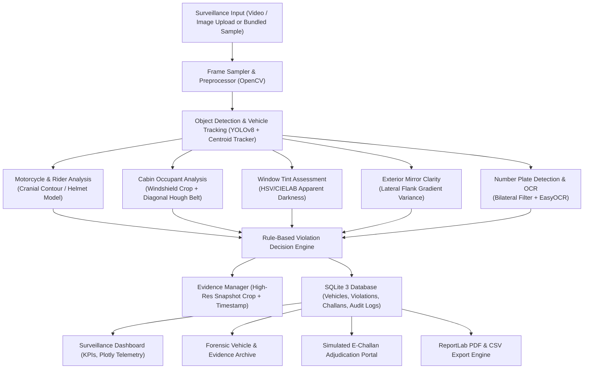

# 🛡️ Vision Guard — AI-Powered Traffic Violation Detection & Road Safety Monitoring System

[](https://www.python.org/)
[](https://github.com/ultralytics/ultralytics)
[](https://streamlit.io/)
[](https://github.com/JaidedAI/EasyOCR)
[](https://www.sqlite.org/)
[](https://opensource.org/licenses/MIT)

> **B.Sc. Computer Science Final-Year / Major Project**  
> An enterprise-grade, modular computer vision surveillance application engineered to monitor highway traffic, identify road safety infractions, recognize vehicle registration numbers, manage forensic evidence, and simulate e-Challan adjudication.

---

## 📑 Table of Contents
1. [Project Overview](#-project-overview)
2. [Key Innovations & Features](#-key-innovations--features)
3. [Technology Stack](#-technology-stack)
4. [System Architecture](#-system-architecture)
5. [Directory Structure](#-directory-structure)
6. [Prerequisites & Environment Setup](#-prerequisites--environment-setup)
7. [Installation & Execution Guide](#-installation--execution-guide)
8. [Demo Login Credentials](#-demo-login-credentials)
9. [Computer Vision & Deep Learning Details](#-computer-vision--deep-learning-details)
10. [Simulated Challan & Notification Workflow](#-simulated-challan--notification-workflow)
11. [Running Automated Tests](#-running-automated-tests)
12. [Troubleshooting Common Issues](#-troubleshooting-common-issues)
13. [Deployment to Cloud (Streamlit Community Cloud / Hugging Face Spaces)](#-deployment-to-cloud)
14. [Privacy, Ethics, & Statutory Limitations](#-privacy-ethics--statutory-limitations)
15. [College Viva Examination Guide (Q&A)](#-college-viva-examination-guide-qa)

---

## 🌟 Project Overview

Traditional traffic enforcement relies heavily on manual officer spot-checks or rigid speed cameras, leaving critical safety violations—such as missing motorcycle helmets, unfastened seat-belts, excessively dark window films, and obscured license plates—unmonitored across vast highway stretches.

**Vision Guard** simulates an automated, AI-assisted highway surveillance camera station. When vehicles enter the camera field of view, Vision Guard:
1. Detects and tracks vehicles across frames using **Ultralytics YOLOv8** and a centroid/IoU temporal tracker.
2. Evaluates road safety compliance:
   - **Motorcycle Rider Helmet Compliance** (dual-mode deep inference + morphological fallback).
   - **Vehicle Occupant Seat-Belt Compliance** (windshield cabin crop + CLAHE + diagonal Hough strap profiling).
   - **Vehicle Window Tint & Apparent Darkness** (HSV/CIELAB luminance spectrometry proxy).
   - **Exterior Mirror Presence & Visibility** (lateral flank gradient protrusion analysis).
   - **Registration Number Plate Detection & OCR** (bilateral filtering + adaptive thresholding + EasyOCR).
3. Enforces an automated **Violation Decision Engine** with multi-tier confidence levels (*Potential Violation*, *Compliant*, *Uncertain / Manual Review*).
4. Persists forensic evidence snapshots and records to an **SQLite 3 database**.
5. Provides an interactive **Simulated E-Challan Adjudication Portal** allowing human officers to review visual evidence, approve/reject citations, export printable PDF notices, and simulate mobile SMS dispatch.

---

## 🚀 Key Innovations & Features

- **High-Tech Surveillance Dark UI:** Built with custom glassmorphism cards, glowing status badges, tactical HUD overlays, and responsive Plotly visual telemetry.
- **Dual-Mode Computer Vision Architecture:** Operates with custom-trained YOLO weights when present, or seamlessly uses computer vision cranial circularity and diagonal Hough line geometry as fallback.
- **Temporal Tracking & Deduplication:** Maintains unique vehicle tracks (`TRK-101`, `TRK-102`), preventing multiple alerts for the same vehicle during its transit.
- **Interactive Violation Lab:** Five dedicated testing benches allowing users to upload or select sample images and inspect intermediate preprocessing masks, edge maps, and confidence metrics.
- **Printable PDF Challans & Audit Reports:** Produces publication-grade PDF e-Challan notices and executive audit summaries using ReportLab.
- **Zero-Friction Offline Demo Mode:** Comes pre-packaged with bundled synthetic test images and a 60-frame traffic video clip, allowing complete evaluation without requiring external videos or downloads.

---

## 🛠️ Technology Stack

| Layer | Technologies |
| :--- | :--- |
| **Programming Language** | Python 3.10 / 3.11 / 3.14 |
| **Computer Vision** | OpenCV 4 (cv2), NumPy, Pillow (PIL), scikit-image |
| **Object Detection** | Ultralytics YOLOv8 (Nano architecture, 80 COCO classes) |
| **Optical Character Recognition** | EasyOCR (CRAFT + ResNet deep PyTorch backend) |
| **Web Dashboard** | Streamlit 1.63+ (Multi-Page Architecture, Dark Surveillance Theme) |
| **Data Visualization** | Plotly Express & Plotly Graph Objects |
| **Persistence Layer** | SQLite 3 (`visionguard.db` with relational schema and indexes) |
| **Document Generation** | ReportLab 5 (Custom flowable PDF generation) |
| **Data Handling** | Pandas 2+ & PyYAML |
| **Test Automation** | Pytest 9+ |

---

## 🏗️ System Architecture



---

## 📁 Directory Structure

```text
VisionGuard/
│
├── app.py                      # Main entrypoint, auth portal, and navigation hub
├── requirements.txt            # Python dependencies
├── README.md                   # Complete documentation and viva guide
├── .gitignore                  # Git tracking rules
├── .env.example                # Environment variable configuration template
│
├── config/
│   └── settings.yaml           # App configuration, thresholds, and fine schedules
│
├── database/
│   ├── schema.sql              # Relational SQLite database schema
│   └── db_manager.py           # Database connection, queries, and demo seeding
│
├── modules/
│   ├── helmet_detection.py     # Motorcycle rider helmet compliance analyzer
│   ├── seatbelt_detection.py   # Occupant seat-belt diagonal strap profiler
│   ├── tint_analysis.py        # Window tint apparent darkness & VLT proxy
│   ├── mirror_analysis.py      # Exterior mirror presence & clarity analyzer
│   ├── number_plate_ocr.py     # Number plate localization and EasyOCR
│   ├── vehicle_tracking.py     # Centroid/IoU vehicle tracker with deduplication
│   ├── violation_engine.py     # Multi-tier violation decision engine
│   └── challan_manager.py      # Mock citation manager, approvals, & PDF/SMS
│
├── pages/
│   ├── 1_Webcam_Helmet_Testing.py # Mode A: Real-time personal webcam helmet detection & temporal smoothing
│   ├── 2_Highway_Surveillance.py  # Mode B: Multi-vehicle tracking, rider association, seatbelt & stop-line
│   ├── 3_Video_Analysis.py        # Recorded video analysis, incursion tracking & MP4 export
│   ├── 4_Violation_Records.py     # Forensic audit registry & human-in-the-loop review
│   ├── 5_Reports_Analytics.py     # Macro safety analytics, Plotly charts & PDF audit reports
│   └── 6_Model_Diagnostics.py     # Model specs, hardware diagnostics & training pipeline
│
├── scripts/
│   ├── prepare_dataset.py      # Dataset splitter & YOLO annotation validator
│   ├── train_model.py          # Transfer learning fine-tuning script
│   └── evaluate_model.py       # Precision, Recall, and mAP evaluation suite
│
├── utils/
│   ├── ui_components.py        # Reusable CSS, headers, badges, and auth guard
│   ├── image_utils.py          # Surveillance HUD overlays and sample generators
│   ├── video_utils.py          # Video frame generator and synthetic clip creator
│   ├── report_generator.py     # ReportLab PDF challan and audit report generator
│   └── validation.py           # File validation, plate regex, and sanitization
│
├── models/
│   ├── README.md               # Model setup, classes, and training guide
│   ├── helmet_detector.pt      # Trained YOLOv8 Helmet Detection weights (With/Without Helmet)
│   └── yolov8n.pt              # Ultralytics YOLOv8 nano base model
│
├── samples/                    # Bundled test images and synthetic traffic video
│   ├── sample_helmet.jpg
│   ├── sample_seatbelt.jpg
│   ├── sample_tint.jpg
│   ├── sample_plate.jpg
│   └── sample_traffic_clip.mp4
│
├── data/
│   ├── README.md
│   └── visionguard.db          # Persistent SQLite database
│
├── evidence/                   # Visual evidence snapshot vault
│   └── README.md
│
└── tests/
    ├── test_database.py        # Database schema and query tests
    ├── test_violation_engine.py# Decision rule logic tests
    └── test_ocr_utils.py       # Plate normalization and file validation tests
```

---

## 💻 Prerequisites & Environment Setup

- **Operating System:** Windows 10/11, macOS, or Linux.
- **Python:** Python 3.10, 3.11, or 3.14 (64-bit recommended).
- **RAM:** 4 GB minimum (8 GB recommended).
- **Storage:** ~1 GB free space for weights, cache, and dependencies.

---

## ⚡ Installation & Execution Guide

### Step 1: Open Terminal in Project Directory
Open PowerShell or Command Prompt and navigate to the project directory:
```powershell
cd "C:\Users\My PC\.gemini\antigravity\scratch\VisionGuard"
```

### Step 2: (Optional but Recommended) Create Virtual Environment
```powershell
python -m venv venv
.\venv\Scripts\Activate.ps1
```

### Step 3: Install Required Dependencies
```powershell
pip install -r requirements.txt
```

### Step 4: Run the Application
Launch the Streamlit web dashboard:
```powershell
streamlit run app.py
```

The web application will open automatically in your default browser at:
`http://localhost:8501`

---

## 🔑 Demo Login Credentials

Vision Guard provides pre-configured credentials for evaluation during academic presentations and viva examinations:

| Role | Username | Password | Access Privileges |
| :--- | :--- | :--- | :--- |
| **Chief Surveillance Officer** | `admin` | `visionguard2026` | Full administrative access, threshold calibration, and adjudication |
| **Field Review Officer** | `officer` | `traffic123` | Case inspection, evidence review, and citation approval |

> *Note: Click the convenient login helper on the sign-in page to fill credentials during live demonstrations.*

---

## 🔬 Computer Vision & Deep Learning Details

### 1. Base Vehicle Detection & Tracking
- **Model:** Ultralytics YOLOv8 Nano (`models/yolov8n.pt`).
- **Classes:** Filtered to traffic entities: `person` (0), `car` (2), `motorcycle` (3), `bus` (5), `truck` (7).
- **Tracker:** `VehicleTracker` associates bounding box centroids across frames using Euclidean proximity, maintaining continuous tracking IDs (`TRK-101`, `TRK-102`) and storing motion history vectors.

### 2. Helmet Detection Pipeline
- If a custom fine-tuned model (`models/helmet_yolo.pt`) is present, it directly runs deep classification.
- Otherwise, the intelligent fallback localizes the rider's cranial region (top 28% of rider bounding box) and analyzes:
  - **HSV Skin Tone Ratio:** Detects bare facial and neck skin.
  - **Cranial Circularity:** Helmets exhibit distinct curved dome boundaries compared to irregular hair silhouettes.
  - **Edge Frequency:** Differentiates smooth shell lacquer from textured hair.

### 3. Occupant Seat-Belt Pipeline
- Front windshield zones are localized in passenger vehicles.
- **CLAHE (Contrast Limited Adaptive Histogram Equalization)** penetrates glare and cabin shadows.
- **Hough Line Transform** scans for diagonal edges oriented at 28° to 68° matching shoulder-to-hip strap geometry.

### 4. Window Tint Apparent Darkness
- Evaluates HSV Value ($V$) and CIELAB Luminance ($L$) across candidate window glass.
- Calculates an **Apparent Darkness Score (0 - 100%)** and **Estimated VLT Proxy**.
- Windows exceeding 65% darkness are flagged for manual review with explicit disclaimers.

### 5. Number Plate Recognition & OCR
- Identifies rectangular plate contours (aspect ratio 2.0 to 6.0).
- Preprocesses via **Bilateral Filtering** (retaining sharp character glyphs while removing road grime) and **Adaptive Gaussian Thresholding**.
- **EasyOCR** extracts character strings, which are normalized using standard alphanumeric patterns.

---

## 🧾 Simulated Challan & Notification Workflow

When visual evidence suggests a violation:
1. A unique mock challan reference is created (e.g., `VG-2026-CH-849201`).
2. An illustrative demonstration fine is computed based on the configurable fine schedule.
3. The case enters the **Pending Review** queue.
4. An authorized officer inspects the evidence in the Adjudication Portal and selects:
   - **Approve Citation**
   - **Dismiss / Reject**
   - **Mark Under Investigation**
5. **Printable PDF Export:** Generates an official notice complete with header, plate details, evidence snapshot, and legal citation text.
6. **Simulated Mobile SMS:** Entering a test phone number generates a formatted smartphone notification preview card in the UI (no actual SMS is dispatched).

---

## 🧪 Running Automated Tests

Run the comprehensive test suite with `pytest`:
```powershell
python -m pytest tests/ -v
```
All 8 automated tests verify:
- Database creation, relational constraints, and demo seeding.
- Vehicle tracking record insertion and plate updates.
- Violation Decision Engine rule triggers and severity classification.
- License plate string normalization and file type validation.

---

## ❓ Troubleshooting Common Issues

### 1. Streamlit Command Not Found
If `streamlit` is not recognized on Windows:
```powershell
python -m streamlit run app.py
```

### 2. EasyOCR Downloads Model on First Run
On the very first OCR execution, EasyOCR downloads CRAFT and recognition model weights (~4MB) to `~/.EasyOCR/model/`. Ensure internet access is available on initial boot, or use the pre-generated bundled samples.

### 3. PyTorch CPU Warning
Vision Guard runs efficiently on standard CPUs. If an NVIDIA GPU with CUDA is present, PyTorch will automatically accelerate inference.

---

## ☁️ Deployment to Cloud

### Option A: Streamlit Community Cloud (Recommended Free Host)
1. Push this repository to GitHub:
   ```bash
   git init
   git add .
   git commit -m "Deploy Vision Guard"
   git branch -M main
   git remote add origin https://github.com/<your-username>/VisionGuard.git
   git push -u origin main
   ```
2. Visit [share.streamlit.io](https://share.streamlit.io/) and log in with GitHub.
3. Click **New app**, select your repository, set the main file path to `app.py`, and click **Deploy**.

### Option B: Hugging Face Spaces
1. Create a new Space on [huggingface.co/spaces](https://huggingface.co/spaces) with SDK set to **Streamlit**.
2. Clone the Space repository and copy the project files.
3. Push to Hugging Face:
   ```bash
   git add .
   git commit -m "Deploy to HF Spaces"
   git push
   ```

---

## ⚖️ Privacy, Ethics, & Statutory Limitations

1. **Local Processing:** By default, all visual frames and OCR data are processed locally on the user's host machine. No private license plates or images are shared externally.
2. **Mandatory Human Verification:** Vision Guard is an AI-assisted decision-support system. It explicitly prohibits automated punitive action without review by a certified traffic enforcement officer.
3. **No Facial Recognition:** The application deliberately avoids facial biometrics or individual person identification.
4. **Photometric Calibration Notice:** Apparent window darkness scores derived from standard RGB images are visual approximations affected by sunlight and reflections. Statutory enforcement under Motor Vehicle Acts requires physical testing with a calibrated photometric tint meter.

---

## 🎓 College Viva Examination Guide (Q&A)

### Q1: What is the core problem Vision Guard addresses?
> **Answer:** Vision Guard automates the detection of non-speed road safety violations (missing helmets, unfastened seatbelts, excessively dark tint, obscured plates) that conventional speed radar cameras fail to detect, providing automated evidence management and officer adjudication.

### Q2: How does the system avoid issuing duplicate citations for the same vehicle in video footage?
> **Answer:** The `VehicleTracker` maintains persistent tracking IDs (`TRK-101`, `TRK-102`) across frames using Euclidean centroid distances. Each tracked vehicle object maintains a `violations_flagged` set, ensuring that once a violation category is logged for that vehicle during its transit, duplicate records are prevented.

### Q3: How is helmet compliance detected without specialized YOLO classes?
> **Answer:** Standard YOLO COCO weights only recognize `motorcycle` and `person`. Vision Guard implements a dual-mode engine: if a custom model is provided, it uses it; otherwise, it isolates the rider's cranial region and uses morphological contour circularity, edge density, and HSV skin tone analysis as an intelligent fallback.

### Q4: Why is EasyOCR used instead of traditional Tesseract?
> **Answer:** EasyOCR utilizes deep CRAFT text detection and a ResNet convolutional feature extractor with a PyTorch backend. This provides substantially higher tolerance against motion blur, perspective tilt, and uneven highway lighting compared to classical Tesseract binarization.

---

## 📄 License
This project is developed for academic evaluation under the **MIT License**.
